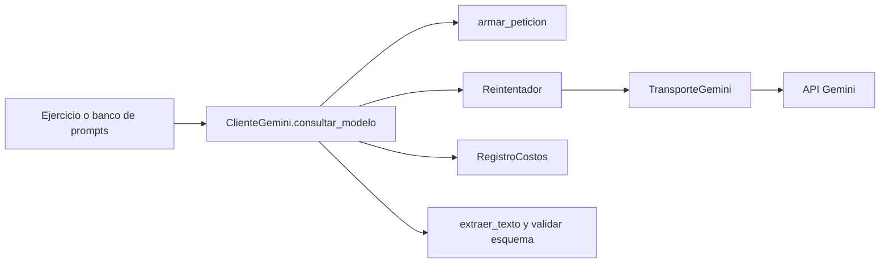

# Diseño del cliente modular — Módulo 2

## Objetivo

Ofrecer una sola operación de consulta reutilizable. El banco de prompts se
adaptó a indicadores y definiciones académicas ficticias; un ejemplo con datos
y respuesta simulados muestra el uso previsto en el proyecto final. El cliente
debe tolerar fallos temporales, detenerse ante errores
permanentes, medir el costo estimado y conservar la validación de respuestas JSON.

## Flujo

El cliente construye el cuerpo una vez. El reintentador repite solamente el
envío. Cuando llega una respuesta HTTP correcta, el cliente registra su uso de
tokens una vez, extrae el texto y, si se proporcionó un esquema, valida el JSON.
El banco de prompts conserva sus instrucciones y esquemas actuales.

## Contrato de errores

| Situación | Excepción interna | Acción del cliente |
| --- | --- | --- |
| Credencial inválida o sin permiso (401/403) | `ErrorAutenticacion` | Propagar; corregir la configuración. |
| Límite de uso (429) | `ErrorTemporal` | Esperar y reintentar; atender `Retry-After` numérico. |
| Servidor (5xx), timeout o conexión | `ErrorTemporal` | Esperar y reintentar. |
| Otro 4xx o JSON HTTP inválido | `ErrorProveedor` | Propagar sin reintento. |
| Se agotan los intentos | `ErrorServicioAgotado` | Mostrar error claro y conservar la causa. |
| Texto, esquema o metadatos inválidos | `ErrorProveedor` o `ValueError` | Propagar; revisar datos/contrato. |

Las clases específicas mantienen compatibilidad con los tipos generales de la
lección: `ErrorAutenticacion` deriva de `ValueError` y `ErrorTemporal` de
`TimeoutError`. El resto del código no depende de esos tipos generales.

## Costos

El registro pertenece a cada instancia de `ClienteGemini`. Cada operación
guarda entrada, salida, razonamiento, total reportado y costo estimado. La
fórmula usa las tarifas del modelo configurado:

`USD = (entrada × tarifa_entrada + (salida + razonamiento) × tarifa_salida) / 1.000.000`

Se preserva la fórmula del proyecto Gate 1. `totalTokenCount` se registra como
dato de observación, pero no se usa para aplicar una tarifa única. El total de
la sesión es la suma de operaciones registradas, no un cargo facturado.

## Pruebas y criterios de aceptación

La suite prueba por separado la clasificación HTTP, el backoff, el costo y la
interfaz pública. Las llamadas de red y las esperas se sustituyen por mocks.
La integración local se considera verificada si:

1. 401/403 no disparan otro intento.
2. 429, 5xx y fallos de conexión permiten un máximo configurable de intentos.
3. Las esperas crecen y respetan el techo; `Retry-After` numérico tiene prioridad.
4. Una consulta exitosa devuelve texto y registra una sola operación, incluso
   cuando necesitó reintentar antes de recibirla.
5. El cliente acepta las instrucciones y esquemas del banco de Gate 1.
6. Las pruebas terminan sin clave real, sin red y sin modificar el registro del
   banco existente.

## Estado de la integración

El paquete `cliente_gemini/` y las pruebas están en la raíz del proyecto. Los
ejemplos del Módulo 2 usan directamente `prompts/banco.py`; el código entregado
para el Gate 1 permanece en `src/` y `prompts/` mientras llega su evaluación.
El ejemplo académico usa un transporte simulado, una clave ficticia y metadatos
de tokens simulados; no consulta fuentes académicas reales ni la API de Gemini.

Quedan pendientes la evaluación del Gate 1, el soporte de `Retry-After` con
formato de fecha HTTP y un ensayo documentado de 429 real. Los 429 simulados
comprueban la lógica de clasificación y reintento, pero no sustituyen ese
ensayo en vivo.
